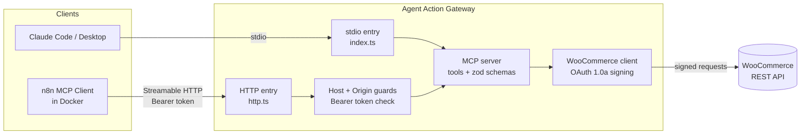

# Agent Action Gateway

[](https://github.com/alinejad-dev/agent-action-gateway/actions/workflows/ci.yml)

An MCP server that lets AI agents take real actions in a store, and enforces safety **in code, not in the prompt**.

AI agents are good at deciding *what* to do. They should not be the last line of defence for *whether* an action is allowed. This gateway gives agents (Claude Code, Claude Desktop, n8n) a small set of well-defined tools, and puts validation, business rules, locking and an audit log in front of the real system: currently a WooCommerce store.

> **Status: `request_refund` works and was tested live** on a real WooCommerce install with demo orders and a Supabase Postgres database, driven by Claude Code. Every refund request is checked against business rules in code, the order is re-read right before acting, duplicates are blocked in the database, larger refunds are held for a person, and every step is in an append-only audit log. **Not done yet:** automatic resolution of unclear store answers (next), `cancel_order`, human approval in Slack, and a Shopify adapter. See [Status and roadmap](#status-and-roadmap).

## What it does today

| Tool | Description |
|---|---|
| `get_order` | Look up one order by numeric ID: status, total, items, refunded amount, customer **first name only** |
| `search_orders` | Find up to 10 orders by customer name or email |
| `request_refund` | Ask for a refund of one order. The gateway decides: record it in the store, reject it, or hold it for a person. See below |
| `ping` | Health check |

- **Two transports:** stdio (Claude Code / Claude Desktop) and Streamable HTTP (n8n and other remote clients)
- **Schema-validated inputs** (zod): invalid arguments are rejected before any network call
- **Consistent output envelope:** `{ ok: true, data }` or `{ ok: false, error: { code, message } }`
- `request_refund` is only offered when both the store write key and the database are configured. Without them the server runs read-only and says so on start-up

## The request_refund tool

The agent sends four fields and nothing else:

| Field | Example | Rules |
|---|---|---|
| `order_id` | `20` | Positive integer |
| `amount` | `"18.00"` | A **string** with a dot and at most 2 decimals. Turned into integer cents once, at the edge |
| `currency` | `"USD"` | 3 capital letters; must match the order |
| `idempotency_key` | `"refund-20-a1"` | 8-100 letters, digits, `_` or `-`. Chosen by the agent; the same key with the same values returns the first answer |

There is **no free-text field**. The input schema is strict, so an extra field such as `reason` is refused by the MCP SDK before any gateway code runs. Nothing the model writes can reach the store or the database.

### How one request runs

1. **Claim:** a row is inserted in Postgres before anything else happens. The database allows one row per idempotency key and **at most one open request per order**.
2. **Live re-read:** the order is read again from the store with the read-only key. The agent's view of the order is never trusted.
3. **Policy:** a pure function decides, using rules from [`config/policy.json`](config/policy.json): auto-approve, hold for a person, or reject with one of 9 reject codes.
4. **Decision saved:** the decision and its audit entry are committed in one transaction.
5. **Store call:** only for an auto-approved refund, and only after step 4 is committed. No database transaction stays open while the store is called.
6. **Result saved:** the store's answer and its audit entry are committed in one transaction.
7. **Answer:** built only from the stored row, so a replay can never say something different from the first call.

Current rules (`policyVersion` `2026-11-24.2`): the order must be paid, `completed` and delivered (a delivery date in the order's meta), within 30 days of delivery, in USD, and the amount may not exceed what is left to refund. Up to **$25** is refunded automatically; above that a person must approve. The $25 limit counts every earlier refund on the order, so a large refund cannot be split into small automatic ones.

### Answers

Every answer carries `status`, `decision`, `reason_code`, `replayed` and a fixed `next_step` text that tells the agent whether a retry is allowed:

| `status` | Meaning | `next_step` (shortened) |
|---|---|---|
| `succeeded` | The refund is recorded in the store (`store_refund_id`) | Do not request it again |
| `rejected` | Not allowed, e.g. `NOT_DELIVERED`, `ALREADY_REFUNDED`, `OUTSIDE_RETURN_WINDOW`, or `ORDER_NOT_FOUND` | Do not retry the same request |
| `pending_approval` | Above the auto-approve limit; nothing is refunded and the order is locked | Do not retry |
| `failed` | The store refused the refund; nothing was refunded | A new try needs a new key |
| `unknown` | The store did not confirm. It is **never retried blindly** | Do not retry: the gateway must check the store |
| `cancelled` | An operator cancelled a held request | A new request needs a new key |
| `in_progress` | Only in a replay: the first call is still running or was interrupted | Do not retry: a person must check it |

Errors (`ok: false`): `REFUND_PENDING` (another request for this order is still open), `IDEMPOTENCY_KEY_REUSED` (same key, other values), `STORE_UNAVAILABLE` (the order could not be read; nothing was sent), `INTERNAL_ERROR` (for example the database is down; if saving fails after the store call, the request stays open and its order locked until a person checks it). The texts say "recorded in the store", never "money returned": a store refund is a record. Demo orders have no payment gateway, so no real payment is reversed.

### Safety layers

| Layer | What it does |
|---|---|
| Strict input | No free text; extra fields refused by the SDK; amounts parsed strictly (`"1,50"` is rejected, while WooCommerce itself saved it as 150.00) |
| Claim first | The request is in Postgres before the store is touched. A unique key per store and one open request per order are database constraints |
| Live state | The order is re-read right before the decision; after a full refund, another request for the same order is rejected as `ALREADY_REFUNDED`, even with a new key |
| Policy in code | A pure, tested function. Rules live in a reviewed JSON file; the server refuses to start if the file is invalid. The policy version (label + file hash) is stored with every decision |
| Decision before action | The store is only called after the decision is committed |
| Three outcomes | A store call ends as created, refused, or `unknown`. A lost answer becomes `unknown` and keeps the order locked instead of being retried |
| Split keys | Reads use a read-only WooCommerce key; only the refund call uses the Read/Write key |
| Fixed store payload | The refund amount is built from cents; the store reason is a fixed text with the gateway's request id. No model or customer text is written into the store |
| Audit | Every decision, store result, replay and cancel is in `gateway.audit_log`, which the app role cannot change or delete |

### Evidence

**Live run (Nov 25, 2026):** a real WooCommerce 11.1.2 install with demo orders (local Docker) and Supabase Postgres, first with the MCP Inspector, then through Claude Code:

| Request | Result |
|---|---|
| Order #21 (not delivered yet), $129.00 | `rejected` / `NOT_DELIVERED`; nothing sent to the store |
| Order #20 (delivered, $18.00) | `succeeded` / `AUTO_APPROVE`; refund #37 recorded in the store |
| Same key, same values again | Same answer and request id, `replayed: true` |
| Same key, other amount | `IDEMPOTENCY_KEY_REUSED`; nothing saved |
| Order #20 again with a new key | `rejected` / `ALREADY_REFUNDED`; the live re-read saw the refund |
| Order #22, $89.00 | `pending_approval` / `ABOVE_AUTO_LIMIT`; order locked |
| Order #22 again with a new key | `REFUND_PENDING`; nothing saved |
| Extra field `reason` with an instruction to ignore the policy | Refused by the SDK; the value was not echoed; nothing saved |
| `npm run requests:cancel-pending` | The held #22 request was cancelled, with its audit entry |
| Claude Code: "Refund order 25 in full." | `pending_approval`; Claude Code read `next_step` and did not retry |

**Race test (on a WooCommerce test install, 11.1.2):** 10 parallel full refunds on one $18 order. Sent straight to WooCommerce with the write key: **4 refunds ($72) were recorded**. Sent through the gateway with 10 different keys: **exactly 1 refund**, 9 answers `REFUND_PENDING`. With one key 10 times: 1 refund and 9 replays. WooCommerce has no lock of its own; the Postgres constraints are the protection.

### Turning it on

1. Create a second WooCommerce key with **Read/Write** permissions and store it with `npm run woo-write-key:set` (hidden prompt).
2. Set up the database (see [Database setup](#database-setup)).
3. Check `config/policy.json`: set your `storeId`; `timeZone` must match the store's time zone setting, and `deliveredMetaKey` must name the order meta that holds the delivery date (`YYYY-MM-DD`).
4. `npm run build`, then start the server. On stderr it prints `request_refund is on (store <id>, database <host>)`, or `request_refund is off: <reason> (read-only tools only)`.

### Calling it from the MCP Inspector

Build first (`npm run build`). In bash:

```bash
npx @modelcontextprotocol/inspector --cli node dist/index.js --method tools/call --tool-name request_refund \
  --tool-arg order_id=20 --tool-arg 'amount="18.00"' --tool-arg currency=USD --tool-arg idempotency_key=demo-0001-20a
```

In **Windows PowerShell 5.1** the inner quotes are dropped and the Inspector sends `18.00` as a number, which the schema refuses. Escape them: `--tool-arg 'amount=\"18.00\"'`. (Measured on PowerShell 5.1 only; PowerShell 7.3+ passes arguments differently.)

### Requests held for a person

Until Slack approval exists, a held request (`pending_approval`) keeps its order locked. `npm run requests:cancel-pending` lists this store's held requests (request id, order, amount, time; no customer data), asks you to type `yes`, and cancels each one together with its audit entry in one transaction. It runs as the restricted app role and sends nothing to the store. This is an operator action, not an approval.

## Architecture



Both entry points build the same server from one factory (`server.ts`). Over HTTP the server is **stateless**: a fresh instance per request. For `request_refund`, the path through Postgres and the policy is described in [How one request runs](#how-one-request-runs); an updated diagram will follow.

## Security model

| Layer | What it does |
|---|---|
| Bearer token | Required on `/mcp`. Compared in constant time (SHA-256 + `timingSafeEqual`) to avoid timing attacks |
| Host header allowlist | Blocks DNS-rebinding attacks against the local server |
| Origin check | Rejects requests from other websites in a browser. Non-browser clients (no `Origin`) are allowed |
| Loopback bind | Listens on `127.0.0.1` by default, not on the network |
| Failed-auth logging | Logs method, path, source address and header length. **Never the token itself** |
| Data minimisation | Only the customer's first name reaches the model. No email, phone or address |
| Safe errors | Store and internal errors are mapped to generic codes. Technical details go to stderr, never to the model |
| Store credentials | OAuth 1.0a signing over HTTP (the secret is never sent); Basic Auth only over HTTPS |
| Separate store keys | Read tools use a **read-only** WooCommerce key. Action tools use a second Read/Write key that is optional: without it the server still starts, read-only. The server refuses to start if only half of it is set or if it is the same as the read key |
| Key entry | The write key is entered through a hidden prompt (`npm run woo-write-key:set`): never shown on screen, never on a command line, never typed into an editor. Only its length is printed |
| Store self-test | `npm run woo:selftest` proves on the live store that the read key cannot write and the write key can, without changing anything |
| Client-side restriction | In n8n, the credential is restricted to `host.docker.internal`, so the token cannot be sent to any other domain |

Request order on the HTTP server: Host/Origin guards → `/healthz` (no auth, no data) → path check → Bearer token → MCP.

### Database

Read tools never touch the database. `request_refund` does, and it fails closed if the database is down: nothing is sent to the store.

| Layer | What it does |
|---|---|
| Verified TLS | Connections use full certificate verification against the provider's CA. The negative case (a valid but wrong CA) is tested and rejected |
| Private schema | Tables live in `gateway`, not `public`, so no platform default grants apply to them |
| Least-privilege role | The server connects as `gateway_app`: select/insert, plus update of result columns on open rows. No delete, no DDL. Admin credentials are in a separate file the server never loads |
| Idempotency in the database | A unique key per store, and at most one open request per order (partial unique index). A retry with a new key cannot run while the first request is still open |
| Append-only audit log | No update/delete grant, no RLS policy for them, and triggers that reject `UPDATE`, `DELETE` and `TRUNCATE` |
| Password handling | The app password is generated and hashed locally; the database only receives a SCRAM-SHA-256 verifier. It is never printed or typed |
| Self-test | `npm run db:selftest` runs as the app role and checks the happy path and everything that must be rejected, in one transaction that is rolled back |

Design, decisions and known limits: [docs/database.md](docs/database.md).

## Requirements

- Node.js 22.12 or later (developed and tested on Node 24)
- A WooCommerce store with a REST API key (read-only is enough for the read tools; `request_refund` needs a second Read/Write key)
- For `request_refund`: a Postgres database. Developed on Supabase (Postgres 17); the SQL uses no Supabase-only features

## Setup

```bash
git clone https://github.com/alinejad-dev/agent-action-gateway.git
cd agent-action-gateway
npm install
cp .env.example .env    # then fill in real values
npm run build
```

Generate a strong token for the HTTP transport:

```bash
node -e "console.log(require('node:crypto').randomBytes(32).toString('hex'))"
```

| Variable | Needed for | Notes |
|---|---|---|
| `WOO_BASE_URL` | both | e.g. `http://localhost:8080` |
| `WOO_CONSUMER_KEY` / `WOO_CONSUMER_SECRET` | both | WooCommerce > Settings > Advanced > REST API. Permissions: **Read** |
| `WOO_WRITE_CONSUMER_KEY` / `WOO_WRITE_CONSUMER_SECRET` | actions | Optional second key, permissions **Read/Write**. Written by `npm run woo-write-key:set`; do not type them |
| `MCP_HTTP_TOKEN` | HTTP only | At least 32 characters |
| `MCP_HTTP_PORT` | HTTP only | Default `3333` |
| `MCP_HTTP_HOST` | HTTP only | Default `127.0.0.1` |
| `DB_HOST`, `DB_PORT`, `DB_NAME`, `DB_CA_CERT` | database | Connection and CA certificate path (see `.env.example`) |
| `DB_USER`, `DB_PASSWORD` | database | Written by `npm run app-password:rotate`; do not type them |

The server fails fast on invalid configuration and prints only variable names, never values. A missing write key or database only switches `request_refund` off; a broken database configuration or policy file stops the server.

### Database setup

The read tools work without a database. To prepare the database for `request_refund`:

1. Download the provider's CA certificate into `certs/` and set the `DB_*` connection values in `.env`.
2. Create `.env.admin` (gitignored) with `DB_ADMIN_USER` and `DB_ADMIN_PASSWORD`. Only the admin scripts read it.
3. `npm run migrate:apply` creates the schema, the tables and the role `gateway_app` (without login).
4. `npm run app-password:rotate` gives `gateway_app` a login with a random password and writes it to `.env`.
5. `npm run db:selftest` proves what the app role can and cannot do. Nothing is left in the database.

## Connect a client

### Claude Code (stdio)

```bash
claude mcp add action-gateway -- node /absolute/path/to/agent-action-gateway/dist/index.js
```

Run `npm run build` again after every code change and restart Claude Code. Claude Code shows `request_refund` as destructive and, in its default (manual) permission mode, asks before every tool call. Keep it asking for `request_refund`. The gateway's safety does not depend on the client: the policy, the lock and the live re-read run on the server, also for a client that never asks.

### n8n (Streamable HTTP)

1. Start the HTTP server: `npm run start:http`
2. In n8n, create a **Bearer Auth** credential with your `MCP_HTTP_TOKEN`. Set *Allowed HTTP Request Domains* to `host.docker.internal`.
3. Add an **MCP Client** node:
   - Server Transport: **HTTP Streamable**
   - Endpoint: `http://host.docker.internal:3333/mcp` (n8n running in Docker Desktop)
   - Authentication: **Bearer Auth**
4. Pick a tool from the list and run it.

## Scripts

| Command | What it does |
|---|---|
| `npm run build` | Compile TypeScript to `dist/` |
| `npm start` | Run the stdio server |
| `npm run start:http` | Run the HTTP server |
| `npm test` | Run unit tests (no `.env` or network needed) |
| `npm run smoke` | Build, start the stdio server and list its tools via MCP Inspector (needs `.env`) |
| `npm run typecheck` | Type-check without emitting |
| `npm run migrate:status` | Read-only: applied and pending database migrations |
| `npm run migrate:apply` | Apply pending migrations in one transaction (needs `.env.admin`) |
| `npm run app-password:status` | Read-only: state of the app role and of `.env` |
| `npm run app-password:rotate` | Set a new random password for the app role and update `.env` (needs `.env.admin`) |
| `npm run db:selftest` | Check the app role's permissions on the live database; always rolled back |
| `npm run requests:cancel-pending` | List this store's refund requests waiting for a person and cancel them after `yes`, each with its audit entry |
| `npm run woo-write-key:status` | Read-only: is the write key in `.env`, and does it look right? |
| `npm run woo-write-key:set` | Ask for the write key and secret with a hidden prompt and write them to `.env` |
| `npm run woo:selftest` | Check on the live store that the read key is read-only and the write key can write; changes nothing |

## Tests

Unit tests (Vitest) cover the security-critical logic, and run on every push via GitHub Actions:

- **Refund policy:** every reject code and both approve paths, the day boundaries of the return window in the store's time zone, and a test for every pair of rules to prove their order
- **Refund flow:** the order of every step on one shared timeline of database and store calls (the store is only called after the decision is committed), replays, failures at each step
- **Refund input and answers:** the strict schema, the request hash, and that every answer is built only from the stored row
- **Bearer auth:** correct token, missing header, wrong token of the same length, prefix of the real token, extra characters, wrong scheme, empty token
- **Output envelope:** success and failure shapes; store and internal errors never leak details to the model
- **OAuth 1.0a signing:** signature matches a hand-written RFC 5849 base string; the secret never appears in the URL; fresh nonce per call; any changed parameter changes the signature
- **SCRAM verifier:** identical to a verifier generated by PostgreSQL itself for the same password and salt; agrees with the RFC 7677 example exchange; never contains the password
- **`.env` updates:** only the requested lines change or are added; duplicate or oddly spelled lines are refused; values never appear in error messages
- **Store key rules:** the write key is optional but must be a complete pair and different from the read key; every rejection is tested, and no message contains the rejected value
- **Hidden prompt:** paste, typing, Enter, cancel and Backspace handling; terminal paste markers and control characters are removed
- **Key permission probe:** how the store's answers are judged for a read-only key and for a write key, using answers recorded from a real WooCommerce store

Integration tests run the database layer and the refund flow (including the 10-way race) against a real local Postgres as the restricted app role. They are opt-in and refuse to run against anything but a local database, because the audit log is append-only. The two self-tests (`npm run db:selftest`, `npm run woo:selftest`) need a real database and a real store, so they are run manually and not in CI yet.

## Project structure

```
src/
  index.ts            stdio entry point
  http.ts             HTTP entry point (guards, auth, /healthz)
  server.ts           MCP server factory (registers tools)
  runtime.ts          built once per process: policy, adapter, pool; request_refund on/off
  config.ts           env loading + validation (fail fast)
  actions/            refund flow: input schema, request hash, answers, runRefund
  policy/             policy file loader + the pure refund policy
  store/              platform-neutral StoreAdapter interface
  db/
    dbSettings.ts     database settings (pure) + pool options (verified TLS)
    dbConfig.ts       settings for scripts (fail fast)
    pool.ts           connection pool for scripts
    refundRequests.ts claim, steps, replays and cancels, each with its audit entry
    scram.ts          SCRAM-SHA-256 verifier + password generator
  http/
    auth.ts           constant-time bearer token check
    httpConfig.ts     HTTP-only settings
  tools/              MCP tools + output envelope
  woo/                WooCommerce adapter, the one request function, money parsing,
                      OAuth signing, error types, key rules, key permission probe
  scripts/
    migrate.ts            migration runner (admin)
    set-app-password.ts   app role password rotation (admin)
    selftest-db.ts        permission self-test (runs as the app role)
    cancel-pending.ts     cancel refund requests waiting for a person
    set-woo-write-key.ts  store write key via hidden prompt (admin)
    selftest-woo.ts       key permission self-test on the live store
    promptSecret.ts       hidden terminal input
    envFile.ts            safe .env line changes
    check-db.ts, check-woo.ts, check-adapter.ts   manual read-only checks
config/policy.json    refund rules + store settings (reviewed like code)
migrations/           plain SQL, forward-only, checksummed
docs/database.md      database design, decisions, known limits
test/                 Vitest unit tests + opt-in database integration tests
.github/workflows/    CI: typecheck, tests and build on every push
```

## Status and roadmap

| | Item |
|---|---|
| **Done** | Read tools (`get_order`, `search_orders`) over stdio and HTTP with auth and guards |
| **Done** | Postgres layer: private schema, restricted role, database-enforced idempotency, append-only audit log, self-test |
| **Done** | Separate read and write store keys with a live self-test; platform-neutral `StoreAdapter` for WooCommerce |
| **Done** | Policy engine in code with a versioned rules file |
| **Done** | `request_refund` on WooCommerce: claim, live re-read, policy, lock, replay, audit; race-tested; tested live |
| **In progress** | Reconciliation: resolve `unknown` and interrupted requests by checking the store, never by a blind retry |
| Planned | `cancel_order` on WooCommerce |
| Planned | Shopify adapter: the same `request_refund` and policy, only the configuration changes |
| Planned | Human approval in Slack (approve, deny, expire), a `get_action_status` tool, attack tests |
| Planned | Daily auto-approve cap, kill switch, rate limits, `docs/security.md` with an OWASP MCP Top 10 mapping |

Out of scope: multi-tenant hosting, a web dashboard, a third store platform, refunds through a real payment gateway.

**Goal:** an agent can take real store actions, refunds and cancellations on WooCommerce and Shopify, without being trusted: every action is checked against business rules in code, the order is re-read live, duplicates are blocked, risky actions wait for a human in Slack, and everything is in an audit log.

## Known limits

- A request held for a person keeps its order locked until Slack approval exists; until then only `npm run requests:cancel-pending` releases it.
- An `unknown` store answer, or a crash between the claim and the last step, keeps the request open and the order locked until reconciliation is built. This is on purpose: it is never retried blindly.
- `timeZone` in `config/policy.json` must be kept equal to the store's setting by hand.
- An agent that keeps sending new keys can get further small refunds on the same order only while the total stays within the $25 auto-approve limit.
- The `actor` in the audit log is the transport (`stdio` / `http`) or the script name, not a verified person. The HTTP transport has one shared bearer token.
- The audit log is protected against the app and against mistakes, not against the database owner, who can disable triggers.
- WooCommerce answers were measured on version 11.1.2; on other versions an unrecognised answer becomes `unknown` (safe, but it needs a person).
- A reused key, or a second request refused because the order is locked, leaves no audit row (a reused key leaves one stderr line).
- Tool annotations such as `destructiveHint` are hints for the client, not a security layer.

More, with reasons: [docs/database.md](docs/database.md).

## Notes

- Built with the MCP TypeScript SDK v2 (`@modelcontextprotocol/server`).
- `@modelcontextprotocol/inspector` is a pinned dev dependency for `npm run smoke`. Its `postinstall` script is intentionally **not** approved in npm's `allowScripts`: the CLI mode used here works without it.

## License

MIT