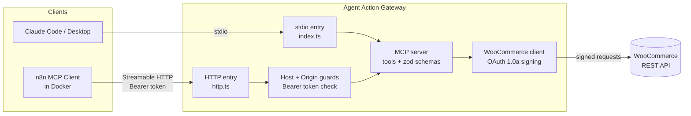

# Agent Action Gateway

[](https://github.com/alinejad-dev/agent-action-gateway/actions/workflows/ci.yml)

An MCP server that sits between AI agents and business systems, and enforces safety **in code, not in the prompt**.

AI agents are good at deciding *what* to do. They should not be the last line of defence for *whether* an action is allowed. This gateway gives agents (Claude Code, Claude Desktop, n8n) a small set of well-defined tools, and puts validation, authentication and data minimisation in front of the real system: currently a WooCommerce store.

> **Status: Phase 1 complete (read-only tools). Phase 2 (safe write actions) is in progress.** The database layer for actions is done: schema with database-enforced idempotency, an append-only audit log, a restricted app role, and a self-test that proves the permissions on the live database. The action tools themselves (refunds, cancellations) with the policy engine and live-state checks are being built; human approval follows in Phase 3. See [Roadmap](#roadmap).

## What it does today

| Tool | Description |
|---|---|
| `get_order` | Look up one order by numeric ID: status, total, items, refunded amount, customer **first name only** |
| `search_orders` | Find up to 10 orders by customer name or email |
| `ping` | Health check |

- **Two transports:** stdio (Claude Code / Claude Desktop) and Streamable HTTP (n8n and other remote clients)
- **Schema-validated inputs** (zod): invalid arguments are rejected before any network call
- **Consistent output envelope:** `{ ok: true, data }` or `{ ok: false, error: { code, message } }`

## Architecture



Both entry points build the same server from one factory (`server.ts`). Over HTTP the server is **stateless**: a fresh instance per request.

## Security model

| Layer | What it does |
|---|---|
| Bearer token | Required on `/mcp`. Compared in constant time (SHA-256 + `timingSafeEqual`) to avoid timing attacks |
| Host header allowlist | Blocks DNS-rebinding attacks against the local server |
| Origin check | Rejects requests from other websites in a browser. Non-browser clients (no `Origin`) are allowed |
| Loopback bind | Listens on `127.0.0.1` by default, not on the network |
| Failed-auth logging | Logs method, path, source address and header length. **Never the token itself** |
| Data minimisation | Only the customer's first name reaches the model. No email, phone or address |
| Safe errors | Store and internal errors are mapped to generic codes. Technical details go to stderr, never to the model |
| Store credentials | OAuth 1.0a signing over HTTP (the secret is never sent); Basic Auth only over HTTPS. Use a **read-only** WooCommerce key |
| Client-side restriction | In n8n, the credential is restricted to `host.docker.internal`, so the token cannot be sent to any other domain |

Request order on the HTTP server: Host/Origin guards → `/healthz` (no auth, no data) → path check → Bearer token → MCP.

### Database (foundation for Phase 2 actions)

Read tools never touch the database. Action tools will, and they fail closed if it is down.

| Layer | What it does |
|---|---|
| Verified TLS | Connections use full certificate verification against the provider's CA. The negative case (a valid but wrong CA) is tested and rejected |
| Private schema | Tables live in `gateway`, not `public`, so no platform default grants apply to them |
| Least-privilege role | The server connects as `gateway_app`: select/insert, plus update of result columns on open rows. No delete, no DDL. Admin credentials are in a separate file the server never loads |
| Idempotency in the database | A unique key per store, and at most one open request per order (partial unique index). A retry with a new key cannot cause a double refund |
| Append-only audit log | No update/delete grant, no RLS policy for them, and triggers that reject `UPDATE`, `DELETE` and `TRUNCATE` |
| Password handling | The app password is generated and hashed locally; the database only receives a SCRAM-SHA-256 verifier. It is never printed or typed |
| Self-test | `npm run db:selftest` runs as the app role and checks the happy path and everything that must be rejected, in one transaction that is rolled back |

Design, decisions and known limits: [docs/database.md](docs/database.md).

## Requirements

- Node.js 22.12 or later (developed and tested on Node 24)
- A WooCommerce store with a REST API key (read-only is enough)
- For the database layer (Phase 2): a Postgres database. Developed on Supabase (Postgres 17); the SQL uses no Supabase-only features

## Setup

```bash
git clone https://github.com/alinejad-dev/agent-action-gateway.git
cd agent-action-gateway
npm install
cp .env.example .env    # then fill in real values
npm run build
```

Generate a strong token for the HTTP transport:

```bash
node -e "console.log(require('node:crypto').randomBytes(32).toString('hex'))"
```

| Variable | Needed for | Notes |
|---|---|---|
| `WOO_BASE_URL` | both | e.g. `http://localhost:8080` |
| `WOO_CONSUMER_KEY` / `WOO_CONSUMER_SECRET` | both | WooCommerce > Settings > Advanced > REST API |
| `MCP_HTTP_TOKEN` | HTTP only | At least 32 characters |
| `MCP_HTTP_PORT` | HTTP only | Default `3333` |
| `MCP_HTTP_HOST` | HTTP only | Default `127.0.0.1` |
| `DB_HOST`, `DB_PORT`, `DB_NAME`, `DB_CA_CERT` | database | Connection and CA certificate path (see `.env.example`) |
| `DB_USER`, `DB_PASSWORD` | database | Written by `npm run app-password:rotate`; do not type them |

The server fails fast on invalid configuration and prints only variable names, never values.

### Database setup

The read tools work without a database. To prepare the database for the action tools:

1. Download the provider's CA certificate into `certs/` and set the `DB_*` connection values in `.env`.
2. Create `.env.admin` (gitignored) with `DB_ADMIN_USER` and `DB_ADMIN_PASSWORD`. Only the admin scripts read it.
3. `npm run migrate:apply` creates the schema, the tables and the role `gateway_app` (without login).
4. `npm run app-password:rotate` gives `gateway_app` a login with a random password and writes it to `.env`.
5. `npm run db:selftest` proves what the app role can and cannot do. Nothing is left in the database.

## Connect a client

### Claude Code (stdio)

```bash
claude mcp add action-gateway -- node /absolute/path/to/agent-action-gateway/dist/index.js
```

### n8n (Streamable HTTP)

1. Start the HTTP server: `npm run start:http`
2. In n8n, create a **Bearer Auth** credential with your `MCP_HTTP_TOKEN`. Set *Allowed HTTP Request Domains* to `host.docker.internal`.
3. Add an **MCP Client** node:
   - Server Transport: **HTTP Streamable**
   - Endpoint: `http://host.docker.internal:3333/mcp` (n8n running in Docker Desktop)
   - Authentication: **Bearer Auth**
4. Pick a tool from the list and run it.

## Scripts

| Command | What it does |
|---|---|
| `npm run build` | Compile TypeScript to `dist/` |
| `npm start` | Run the stdio server |
| `npm run start:http` | Run the HTTP server |
| `npm test` | Run unit tests (no `.env` or network needed) |
| `npm run smoke` | Build, start the stdio server and list its tools via MCP Inspector (needs `.env`) |
| `npm run typecheck` | Type-check without emitting |
| `npm run migrate:status` | Read-only: applied and pending database migrations |
| `npm run migrate:apply` | Apply pending migrations in one transaction (needs `.env.admin`) |
| `npm run app-password:status` | Read-only: state of the app role and of `.env` |
| `npm run app-password:rotate` | Set a new random password for the app role and update `.env` (needs `.env.admin`) |
| `npm run db:selftest` | Check the app role's permissions on the live database; always rolled back |

## Tests

Unit tests (Vitest) cover the security-critical pure logic, and run on every push via GitHub Actions:

- **Bearer auth:** correct token, missing header, wrong token of the same length, prefix of the real token, extra characters, wrong scheme, empty token
- **Output envelope:** success and failure shapes; store and internal errors never leak details to the model
- **OAuth 1.0a signing:** signature matches a hand-written RFC 5849 base string; the secret never appears in the URL; fresh nonce per call; any changed parameter changes the signature
- **SCRAM verifier:** identical to a verifier generated by PostgreSQL itself for the same password and salt; agrees with the RFC 7677 example exchange; never contains the password
- **`.env` updates:** only the requested lines change; duplicate or oddly spelled lines are refused; values never appear in error messages

The database self-test (`npm run db:selftest`) is separate: it needs a real database, so it is run manually and not in CI yet.

## Project structure

```
src/
  index.ts            stdio entry point
  http.ts             HTTP entry point (guards, auth, /healthz)
  server.ts           MCP server factory (registers tools)
  config.ts           env loading + validation (fail fast)
  db/
    dbConfig.ts       database settings + CA certificate
    pool.ts           shared connection pool (verified TLS)
    scram.ts          SCRAM-SHA-256 verifier + password generator
  http/
    auth.ts           constant-time bearer token check
    httpConfig.ts     HTTP-only settings
  tools/              MCP tools + output envelope
  woo/                WooCommerce client, OAuth signing, error types
  scripts/
    migrate.ts            migration runner (admin)
    set-app-password.ts   app role password rotation (admin)
    selftest-db.ts        permission self-test (runs as the app role)
    envFile.ts            safe .env line replacement
    check-db.ts, check-woo.ts   manual connection checks
migrations/           plain SQL, forward-only, checksummed
docs/database.md      database design, decisions, known limits
test/                 Vitest unit tests
.github/workflows/    CI: typecheck, tests and build on every push
```

## Roadmap

- **Phase 2: Safe actions** *(in progress)*. `request_refund` and `cancel_order` behind a policy engine (rules in config, e.g. auto-approve small refunds, block outside the return window), live re-fetch of the order before acting, idempotency keys, and an audit log in Postgres. Store access goes through a platform-agnostic `StoreAdapter` interface, so actions are not tied to WooCommerce. *Done so far:* database schema, migration runner, restricted app role, password rotation, self-test. *Next:* `StoreAdapter`, policy engine, the tools.
- **Phase 2.5: Shopify adapter.** The same `StoreAdapter` implemented for Shopify (GraphQL Admin API), starting with `get_order` and `request_refund`. The policy engine and safety checks stay unchanged across both stores.
- **Phase 3: Human in the loop.** Slack approval for sensitive actions, an approval-status tool, and attack tests (double-refund race, prompt injection in customer text).
- **Phase 4: Ship.** Demo video and extended docs.

## Notes

- Built with the MCP TypeScript SDK v2 (`@modelcontextprotocol/server`).
- `@modelcontextprotocol/inspector` is a pinned dev dependency for `npm run smoke`. Its `postinstall` script is intentionally **not** approved in npm's `allowScripts`: the CLI mode used here works without it.

## License

MIT